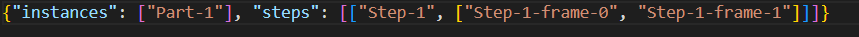

# Abaqus output database to VTK converter

## Introduction

Abaqus output database (.odb extension) is a binary file native to Abaqus. To access the data from ODB file, without reverse engineering, is to use official Abaqus APIs which are provided in Python or C++. This project provides a converter implemented in Python and C++. I started this project pre-AI era and now it has been completely reworked with AI. See [architecture](/doc/python-architecture.md) and [refactor plan](/doc/python-refactor-plan.md), which included a 5 phase migration: [phase 1](/doc/python-phase1-results.md), [phase 2](/doc/python-phase2-results.md), [phase 3](/doc/python-phase3-results.md), [phase 4](/doc/python-phase4-results.md), [phase 5](/doc/python-phase5-results.md). The pipeline has been optimized with [ascii-write-optimization](/doc/python-ascii-write-optimization.md), [label-lookup-optimization](/doc/python-label-lookup-optimization.md), [mesh-snapshot-optimization](/doc/python-mesh-snapshot-optimization.md), [mesh-text-optimization](/doc/python-mesh-text-optimization.md), [row-format-optimization](/doc/python-row-format-optimization.md), and [source-cache-optimization](/doc/python-source-cache-optimization.md).

If you want to know more about the design of ODB2VTK, checkout this [article](https://www.sciencedirect.com/science/article/pii/S2352711023000274).

## Agent skill

[Watch the odb2vtk_core skills video](res/odb2vtk_core%20skills%202026-10-27%20232500.mp4)

The shared [odb2vtk skill](skills/odb2vtk/SKILL.md) lets Claude Code and Codex
inspect and convert ODBs using `odb2vtk_core`. Keep `skills/odb2vtk` as the source
package and copy the complete folder to the desired project's skill location:

| Agent | Project installation | Explicit invocation |
| --- | --- | --- |
| Codex | `.agents/skills/odb2vtk/` | `$odb2vtk` |
| Claude Code | `.claude/skills/odb2vtk/` | `/odb2vtk` |

Install or update both agents' project-local copies with Make and `uv`:

```sh
make install-skills
```

On Windows without Make, run `uv run --no-project python tools/install_skills.py`.
Use `--agent codex` or `--agent claude` with the script to select one agent, or
`--project C:/work/another-project` to install into another existing project.
Re-run installation after updating the source skills. Generated copies in this
checkout are Git-ignored; other agent settings are left untouched. The package follows the
[Agent Skills standard](https://agentskills.io/specification); installation
locations are documented by [Codex](https://learn.chatgpt.com/docs/build-skills)
and [Claude Code](https://code.claude.com/docs/en/skills).

The converter checkout and Abaqus installation are separate prerequisites. If
the agent is working elsewhere, supply the checkout path or set `ODB2VTK_ROOT`
for it to find the backend; the [usage reference](skills/odb2vtk/references/usage.md)
explains package discovery. For example: "Use odb2vtk to export Part-1, Step-1
frames 0 and 1 from C:/work/Job-1.odb in binary format."

## Usage Python


Run the following commands from the repository's `python` directory (`cd python`
from the repository root). ODB access requires Abaqus Python.

For library use, import `AbaqusSource`, `Converter`, `Selection`, and
`OutputOptions` from `odb2vtk_core`. See the [library guide](doc/python-converter-interface.md).
From other working directories, set `PYTHONPATH` to the repository's absolute
`python` directory.

`abaqus python -m odb2vtk_core --header 1 --odbFile <my_odb_file_path>/my_odb_file.odb`

This will open the odb file, extract instances, steps, and frames, and save them into a JSON file in the same directory of the odb file.



`abaqus python -m odb2vtk_core --header 0 --instance "Part-1" --step "Step-1:0,1" --odbFile <my_odb_file_path>/my_odb_file.odb`

With 0 passed to header, it will write vtu data for instance "Part-1" at "Step-1" with frame number 0 and 1.

Add `--format binary` to write uncompressed appended binary VTU files. The
default is `--format ascii`; both modes use the same `.vtu` names and PVD
references. Binary avoids decimal formatting and works with VTK/ParaView readers.
The option also works with `python -m odb2vtk_core.parallel`. See the
[binary serialization results](doc/python-binary-serialization.md) for timing,
file sizes, precision and validation details.

`abaqus python -m odb2vtk_core --header 0 --instance "Part-1" "Part-2" --step "Step-1:0,1" "Step-2:0,1,2,3,4,5" "Step-3:0,1,2,3" --odbFile <my_odb_file_path>/my_odb_file.odb`

The above command will convert frame 0 to 1 in step 1, 0 to 5 in step 2, and 0 to 3 in step 3 for instance "Part-1" and "Part-2".

Convert frames in parallel using ordinary Python, with the Abaqus command on
`PATH`:

```text
python -m odb2vtk_core.parallel --header 0 --instance "Part-1" "Part-2" --step "Step-1:1" "Step-3:2" --odbFile ./Job-1.odb --jobs 2 --writeHistory 1 --format binary
```

The runner validates the request in Abaqus, converts one frame per worker, then
exports history once and writes a PVD after all workers succeed. This command
produces:

```text
project/
|-- Job-1.odb
`-- Job-1/
    |-- Job-1.csv
    |-- Job-1.pvd
    |-- Step-1_1.vtu
    `-- Step-3_2.vtu
```

Serial frame export does not write a PVD automatically. Add `--writeHistory 1`
for history CSV, or index already-exported VTUs with the same selection and
`--writePVD 1`:

```text
abaqus python -m odb2vtk_core --header 0 --instance "Part-1" --step "Step-1:0,1" --odbFile <my_odb_file_path>/my_odb_file.odb --writePVD 1
```

Use `--suffix _name` to give separate selections their own output directories.
Both implementations require explicit comma-separated frame indices; range
syntax such as `Step-1:0-1000` is unsupported.

See the [CLI and parallel runner guide](doc/python-cli.md) for all options,
statuses and execution details.

From the repository root, the numerical conversion and serialization modules in
`python/odb2vtk_core` can be tested with ordinary Python and NumPy, without an
Abaqus installation:

```text
python -m unittest discover -s python/tests -v
```

The [library guide](doc/python-converter-interface.md) describes complete export
requests; the [source interface](doc/python-source-interface.md) covers ODB
ownership and source injection. The [architecture guide](doc/python-architecture.md)
describes the maintained modules and supported runtimes.

## Build C++ with CMake

The C++17 implementation supports the same serial export modes and formats as
Python. Final validation covers 42 native VTUs and 284 field arrays matching
Python on the same ODB bytes. See the [parity and performance results](doc/cpp-phase5-results.md),
[CLI guide](doc/cpp-cli.md) and [performance guide](doc/cpp-performance.md).

From the repository root, build the core without Abaqus:

```powershell
cmake -S cpp -B cpp/build/pure -G "Visual Studio 17 2022" -A x64
cmake --build cpp/build/pure --config Release
ctest --test-dir cpp/build/pure -C Release --output-on-failure
```

To build the native executable, configure a separate directory with
`-DODB2VTK_BUILD_NATIVE=ON` and
`-DABQ_SDK_ROOT=C:/ABAQUS/2025/EstProducts`. See the
[build guide](doc/cpp-build.md) for complete commands, required SDK libraries,
runtime DLL paths and optional real-ODB tests. Native builds require an installed
SDK and an explicit SDK root.

The native CLI writes `Job-1.json` for header mode and VTUs under `Job-1`:

```text
ODB2VTK.exe --header 1 --odbFile C:/temp/Job-1.odb
ODB2VTK.exe --header 0 --odbFile C:/temp/Job-1.odb --instance L-SHAPE-PART-1 --step Step-1:0,1 --format binary --writeHistory 1
ODB2VTK.exe --header 0 --odbFile C:/temp/Job-1.odb --instance L-SHAPE-PART-1 --step Step-1:0,1 --writePVD 1
```

ASCII is the default. History defaults to off, and normal frame export writes
no PVD. `--writePVD 1` indexes existing VTUs without rewriting them. Suffixes and
explicit instance/step/frame order follow Python. ODB files must be compatible
with the installed SDK; access is read-only, with input hashes verified.
The [maintained C++ interface](doc/cpp-writers.md) also supports injected sources
and direct stream writers. Native parallel coordination remains a follow-up.

## Validated runtimes

Both native implementations are validated with Abaqus 2025 HF1 on Windows x64.
Python conversion uses Abaqus Python 3.10 and bundled NumPy. The pure Python
modules are also tested with CPython 3.12 and NumPy without Abaqus.

ODB files must be compatible with the installed Abaqus SDK. See the
[Python runtime details](doc/python-architecture.md#supported-and-validated-runtimes)
and [C++ build guide](doc/cpp-build.md) for the validated environments.
