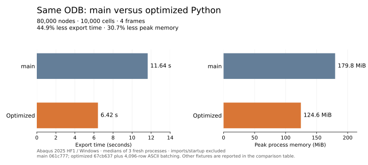

# Local main versus the optimized Python exporter

Measured on 2026-10-26 with Abaqus 2025 HF1 on Windows x64, bundled Python
3.10.5 and NumPy 1.22.4. This compares the complete refactor plus ASCII batching
against the original code on local `main`, not just the batching change.

- Original: local `main` at `061c777`, checked out unchanged in a separate worktree.
- Optimized: `ai-refactor` at `67cb637` plus the 4,096-row ASCII batching change.
- Inputs: exactly the same ODB bytes, instance names, and frame indices for both
  versions. Fixture SHA-256 values were checked before and after the runs.

The separate checkout preserved the current uncommitted work. The primary
workspace remained on `ai-refactor`; no changes were made to `main`.

## Export time

Three fresh Abaqus processes per version and fixture, run sequentially in
alternating order. Medians:

| Fixture | Frames | Main seconds | Optimized seconds | Change |
| --- | --- | ---: | ---: | --- |
| Job-1: 3,840 nodes, 2,604 cells | 0, 1 | 0.576351 | 0.419490 | **27.2% less time** |
| 2D planar: 99 nodes, 80 cells | 0, 1 | 0.105745 | 0.111314 | 5.3% more time, about 5.6 ms |
| Generated: 80,000 nodes, 10,000 cells | 0, 1, 2, 3 | 11.636111 | 6.416532 | **44.9% less time; 1.81x speedup** |

Each version opened the ODB, prepared its selection/mesh, exported VTUs and a
PVD, and explicitly closed the ODB. Both used their own public interface and
performed the same selected frame exports. Imports and SDK/launcher startup were
excluded from workflow timing. These runs did not export history or header JSON,
run parallel workers, or enable profiling instrumentation.

The original `main` received no fixes or performance patches. This is a direct
comparison with that branch's code, unlike the earlier pre-refactor snapshot
which already included the two original correctness fixes.

## Peak memory

Median peak process working set, including interpreter and SDK allocations:

| Fixture | Main MiB | Optimized MiB |
| --- | ---: | ---: |
| Job-1 | 100.19 | 100.55 |
| 2D planar | 96.52 | 99.75 |
| Generated | **179.81** | **124.61** |

On the generated workload, peak memory fell by **55.20 MiB, or 30.7%**. On the
tiny cases, fixed interpreter/module and normalized-source costs can outweigh
the reduction in buffered XML. Small differences should not be interpreted as
exact allocation sizes; they include native/runtime variability.

## Output agreement

All **eight VTUs** matched in mesh topology, field associations, component
metadata, and numerical arrays using `rtol=1e-12`, `atol=1e-12`. Each original
and optimized VTU also loaded through VTK without reader error/warning events;
coordinates and all point/cell arrays matched exactly after reader conversion.
PVD entries and references matched semantically.

Expected XML changes were recorded separately: VTU version `1,0` became `1.0`,
and active-array attributes now select a valid array by its exact name instead
of a quoted list. Non-nine-component stress arrays remain ordinary arrays.
There were no unexpected XML or numerical differences on these fixtures.

These checks establish agreement for the selected cases, not universal equality
with the original implementation's history or integration-point behavior. Those
correctness changes remain documented in the phase results.

## Interpretation and records

The larger case benefits substantially from the combined refactor and bounded
ASCII writes. The tiny planar case is about 5.6 ms slower, so the result is
workload-dependent. Three samples and warm OS file caches do not establish a
production-wide performance guarantee. The generated ODB tests moderate scaling,
not a multi-gigabyte solver database or every element/field configuration.

The [recorded samples, code/input hashes, and semantic comparisons](validation/python-main-comparison.json)
preserve all 18 timing runs. The original branch was checked out under
`%TEMP%/odb2vtk-main-compare-10acd16029f74db6b37a27aeafefeb83/main`; benchmark
harnesses and full output files remain in that task directory and the existing
fixture directories. Repository ODB files were not upgraded or modified.

See the [batching experiment](python-ascii-write-optimization.md) for the
incremental writer improvement and [phase profile](python-profiling-results.md)
for the original conversion breakdown.
