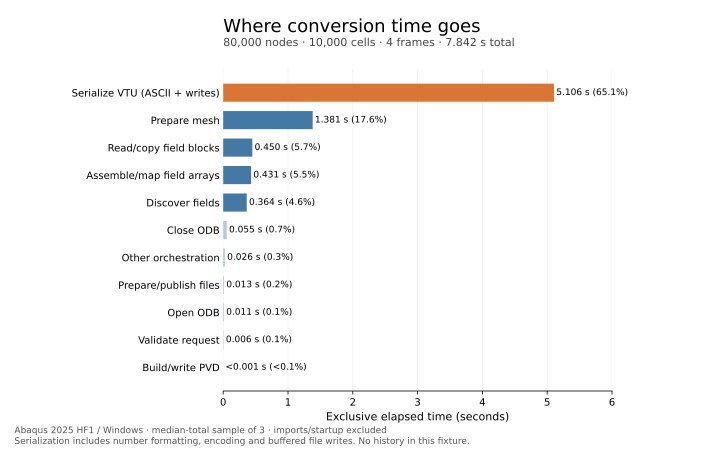

# Python conversion timing by phase

This records the original row-at-a-time writer. The subsequent
[ASCII batching optimization](python-ascii-write-optimization.md) reduced the
generated model's median workflow time by 18.6%; its own measurements are
recorded separately in that guide.

Measured on 2026-10-26 against conversion commit `67cb637`, using Abaqus 2025
HF1 on Windows x64, Python 3.10.5 and bundled NumPy 1.22.4. Conversion code was
not changed. The new validation script instruments the existing export workflow
and produces a JSON breakdown, per-field timings, and optional cProfile data.

**ASCII VTU serialization is the largest optimization opportunity.** On the
generated 80,000-node, four-frame ODB it consumed 65.1% of workflow time, followed
by mesh preparation at 17.6%. Numerical field assembly consumed 5.5%.



## What each phase includes

Timings are exclusive: nested phases are subtracted from their parents. For
example, the writer requests fields lazily, but source reads and field assembly
are removed from its serialization time. A source iterator is timed while being
advanced, not while its yielded block is being used by the caller.

| Phase | Included work |
| --- | --- |
| Open ODB | `AbaqusSource.open`, after SDK imports |
| Validate request | Selection/source metadata checks and destination validation |
| Prepare mesh | Read labels/geometry, check consistency, build maps, flatten VTK topology |
| Discover fields | Query names/layouts/section points/IP counts; plan output arrays |
| Read field blocks | SDK field/subset/centroid queries, iterator advancement, copy native block arrays |
| Assemble fields | Allocate final arrays, map labels/IPs, assign values, transform orientations; excludes reads |
| Serialize VTU | XML and number formatting, character encoding, and buffered text writes; excludes reads/assembly |
| Prepare/publish files | Directory/temp-file creation, stream setup, final flush/close, replacement and cleanup |
| History conversion | Read/assemble/serialize history; excludes validation and publication |
| Build/write PVD | Build collection entries and serialize PVD; excludes publication |
| Close ODB | Native source closure and source-cache cleanup |
| Other orchestration | Loop/result bookkeeping, timing/patch setup and teardown, uncategorized overhead |

Serialization includes buffered I/O, so these measurements do not isolate pure
CPU formatting from every OS write. File publication is not a measure of total
disk I/O. The function profile below identifies substantial formatting and
encoding work within serialization.

## Workflow results

Three fresh processes per fixture per mode, with alternating instrumented/control
order. Each profile exported selected frames plus PVD. The bundled models also
exported history; the generated fixture has no history and omitted that operation.
No header-only operation or parallel scheduling is included.

The phase table uses the sample with the median **total** time for each fixture,
so its phase values add to its total. It does not add independently selected
phase medians from different runs. Outer timer setup/teardown is assigned to
orchestration. Seconds are rounded here; the
[recorded JSON](validation/python-phase-profile.json) retains full precision.

| Exclusive phase | Job-1: 2 frames | 2D planar: 2 frames | Generated: 4 frames | Generated share |
| --- | ---: | ---: | ---: | ---: |
| Open ODB | 0.013669 | 0.013027 | 0.011315 | 0.14% |
| Validate request | 0.003930 | 0.003194 | 0.006209 | 0.08% |
| Prepare mesh | 0.121156 | 0.003647 | 1.380714 | 17.61% |
| Discover fields | 0.016266 | 0.010495 | 0.363537 | 4.64% |
| Read field blocks | 0.040126 | 0.017729 | 0.449528 | 5.73% |
| Assemble fields | 0.011427 | 0.001067 | 0.430566 | 5.49% |
| Serialize VTU | 0.192992 | 0.004722 | 5.105837 | 65.11% |
| Prepare/publish files | 0.006636 | 0.004783 | 0.013175 | 0.17% |
| History conversion | 0.003555 | 0.003206 | — | — |
| Build/write PVD | 0.000136 | 0.000081 | 0.000114 | <0.01% |
| Close ODB | 0.049526 | 0.057664 | 0.054946 | 0.70% |
| Other orchestration | 0.003555 | 0.002471 | 0.026329 | 0.34% |
| **Total** | **0.462972** | **0.122086** | **7.842270** | **100%** |

Job-1 contains 3,840 points and 2,604 cells; the planar model contains 99 points
and 80 cells. The generated fixture contains 80,000 points and 10,000 C3D8R cells,
with U/RF, four nodal scalars, stress at one integration point, and the exported
orientation array. Its VTUs and PVD total 52,551,564 bytes (about 50.1 MiB).

The planar case spends 47% of its workflow closing the ODB. That roughly 50–58 ms
native cleanup cost is small on the larger workload. Avoid interpreting the tiny
fixture's percentages as the priority for larger conversions.

## Measurement overhead and startup

Controls execute the same public export operations with detailed method/iterator
instrumentation disabled. Instrumented/control output files matched byte-for-byte
for all three fixtures. Each instrumented run also checked that exclusive phase
totals account for its measured workflow duration. Control runs retain only the
two coarse ODB open/close clocks; these are not reported as a phase breakdown.

| Fixture | Control median seconds | Instrumented median seconds | Observed difference |
| --- | ---: | ---: | ---: |
| Job-1 | 0.464032 | 0.462972 | -0.23% |
| 2D planar | 0.116192 | 0.122086 | +5.07% (about 6 ms) |
| Generated | 7.819557 | 7.842270 | +0.29% |

These are observed median differences, including OS variation, not confidence
intervals. The negative Job-1 difference is measurement noise. Generated profiled
samples ranged from 7.814 to 7.928 seconds; three samples do not establish a
production performance distribution.

Package/NumPy/SDK imports are measured separately: control medians were 0.185,
0.173, and 0.180 seconds respectively. Parent-observed process durations were
0.889, 0.532, and 8.245 seconds. Those include launcher/interpreter startup,
script setup, imports, conversion, reporting, and teardown. They must not be
added to workflow timings. OS file caches were not cleared, and this is not a
cold-storage benchmark. Full CLI parsing and parallel worker overhead need
separate profiling if those become optimization targets.

## Function hotspots and optimization order

A separate cProfile run on the generated fixture took 10.300 seconds versus
7.842 seconds with coarse phase instrumentation. Its tracing overhead makes it
useful for locating calls, not for replacing the phase totals above. It recorded
18,530,881 calls, including:

| Function / operation | Calls | Self seconds in cProfile run |
| --- | ---: | ---: |
| Per-value generator in `writers._write_rows` | 7,120,000 | 2.622 |
| Text stream `write` | 2,760,282 | 1.310 |
| `writers._write_rows` itself | 40 | 1.231 |
| String `join` | 2,360,419 | 0.939 |
| Native coordinate extraction generator in `source.mesh` | 80,001 | 0.624 |
| Windows character-map encoder | 2,760,282 | 0.580 |
| Windows `cp1252.encode` wrapper | 2,760,282 | 0.502 |
| Native node-label extraction generator | 80,001 | 0.501 |

Self times exclude child calls. Generator call counts include resumptions and
must not be treated as a count of output values. Source code lines and further
hotspots are retained in the JSON.

Recommended next experiments, in order:

1. **Batch ASCII output in bounded chunks.** Reduce millions of tiny writes and
   repeated encoding calls while retaining the current number formatting,
   component order, and storage types. Scalar formatting is also worth a focused
   experiment: the four scalar arrays consumed 2.332 seconds of serialization,
   versus 1.474 seconds for U/RF together. Review explicit UTF-8 output alongside
   this work; the measured default stream used Windows CP1252. Benchmark each
   change independently and verify arrays, precision, non-ASCII labels, and memory.
2. **Reduce native mesh traversal costs.** Profile and then reduce repeated SDK
   attribute reads and separate node passes while preserving label order,
   owned arrays, and mesh validation. This phase runs once per request and took
   1.381 seconds on the generated fixture.
3. **Reuse native frame/field lookups within the current frame.** The source
   repeatedly traverses step/frame/field repositories during discovery and
   block reads. Any cache should be bounded to current processing data and
   cleared on closure. Discovery plus field reading together account for 10.4%.
4. **Optimize label placement after measuring the earlier changes.** Assembly is
   5.5%; its nodal label-map list comprehension appeared in the function profile,
   but offers a smaller total opportunity than serialization and mesh work.

If serialization alone became twice as fast, the generated workflow would
theoretically fall from 7.842 to about 5.289 seconds, a 33% reduction. This is an
estimate from the phase shares, not an achieved speedup. Binary/compressed VTK
would be a separate format decision. No optimization was applied in this work.

## Reproduce

From the repository root, with a compatible ODB and a writable report directory:

```text
abaqus python python/validation/profile_exports.py --odb C:/temp/scaling.odb --instance PART-1-1 --frames 0,1,2,3 --suffix _profile --report C:/temp/profile.json
```

Use `--history` to include history export, `--no-phases` for a control run, or
`--cprofile C:/temp/conversion.prof` for a separate function-profile run. Add a
unique suffix for each independent output set. Reports include per-frame body
times (discovery through VTU serialization, excluding file publication) and
per-output-field read/assembly/serialization times. Mesh XML and topology text
are included in total serialization but have no field entry.

The script temporarily wraps converter/source methods and writer calls inside
one process and restores them afterward. Production modules gain no timing
hooks or runtime dependencies. The generated fixture can be recreated using
`python/validation/create_benchmark_odb.py`; benchmark ODBs, output files, raw
`.prof` files, and environments remain outside the repository.
